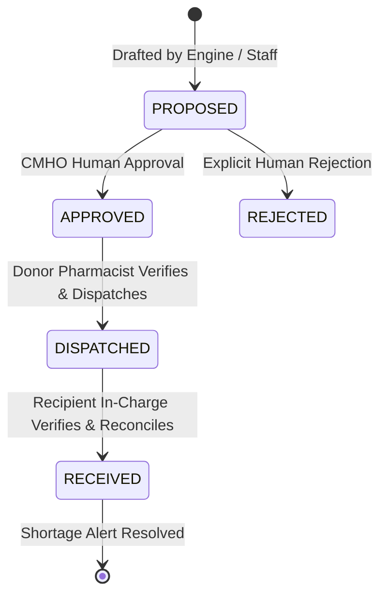

# Smart Health — Public Healthcare Operations & Supply-Chain Intelligence

> **AI-assisted district operations, deterministic medicine supply-chain intelligence, and redistribution workflows for rural public healthcare networks in India.**

---

> [!WARNING]
> **SIMULATED DEMO ENVIRONMENT (SYNTHETIC DATA ONLY)**  
> All facility names, geographical coordinates, medicine stock levels, telemetry records, and patient footfall are **100% synthetic** and designed specifically for hackathon demonstration. This application is **not** connected to live National Health Mission (NHM), e-Aushadhi, or state government servers, and contains **zero real patient data**. The demo persona selector is a walkthrough convenience and does not constitute production authentication or security boundaries.

---

## 1. Chosen Vertical & Problem Context

### Vertical: Public Healthcare Operations & Medicine Supply-Chain Management (India)
In rural India, the public healthcare delivery network follows a tiered hierarchy:
- **Sub-Centres (SCs) & Primary Health Centres (PHCs):** Frontline facilities providing primary care, maternal/child health, and outpatient management.
- **Community Health Centres (CHCs):** Secondary referral hubs equipped with inpatient beds, diagnostic labs, and bulk medicine storage.
- **Chief Medical and Health Officer (CMHO):** District administrative authority overseeing healthcare logistics, staffing, and epidemic response.

### The Problem
During seasonal outbreaks (e.g., monsoon waterborne diarrheal outbreaks, vector-borne surges), frontline PHCs experience sudden demand spikes for essential items such as **Oral Rehydration Salts (ORS)**, **Amoxicillin**, and **Anti-Snake Venom (ASV)**:
1. **Last-Mile Stockouts:** Routine state replenishment cycles take weeks. Frontline PHCs run out of critical medicines within 48–72 hours of an outbreak.
2. **Asymmetric District Hoarding:** While a remote PHC runs out of life-saving ORS, a nearby CHC often holds excess buffer stock (30–60 days of supply) that sits idle.
3. **Absence of Safety Guardrails:** Ad-hoc manual reallocations often strip donor facilities of their own reserves, causing cascading shortages.
4. **Paper-Driven Latency:** Transfer approvals, gate passes, and physical dispatch rely on manual paperwork and unverified phone calls, delaying intervention.

**Smart Health** addresses this vertical by providing real-time district visibility, deterministic stockout risk forecasting, automated inter-facility redistribution recommendations with strict donor safety rules, an immutable double-entry stock ledger, and human-in-the-loop transfer authorization.

---

## 2. Approach and Core Logic

Smart Health adheres to the **Ponytail Minimal Implementation Principles** (smallest correct solution, zero speculative bloat, stdlib/native capabilities first, non-negotiable data integrity).

### A. Separation of Mathematics and AI Reasoning
- **Pure Deterministic Calculation Engine (`lib/engine/`):** All mathematical calculations—days of stock remaining, weighted consumption burn rates, stockout lead-time thresholds, facility health scores (0–100), and redistribution feasibility—execute in pure, deterministic TypeScript with **zero** external network, database, or LLM dependencies.
- **Mathematical Invariant:** AI models **never** calculate numbers, days of stock, or financial metrics. AI is strictly confined to synthesizing grounded explanations from verified engine outputs.

### B. Mandatory Donor Safety Reserve Rule ($\ge 21$ Days)
A donor facility is strictly disqualified from transferring stock unless its post-transfer inventory satisfies:
$$\text{Post-Transfer Days of Stock} = \frac{\text{Total Available Stock} - \text{Transfer Quantity}}{\text{Weighted Daily Burn Rate}} \ge 21.0 \text{ days}$$
This mathematical guarantee prevents a well-intentioned transfer from triggering a secondary shortage at the donor facility.

### C. Immutable Double-Entry Stock Ledger
No inventory quantity is modified in isolation. Every stock balance transition requires a corresponding record in `stock_transactions`:
- **Dispatch:** Decrements source facility stock and logs a `DISPATCH` entry with negative quantity delta, proposal ID, and dispatching pharmacist name.
- **Arrival:** Increments recipient facility stock and logs an `ARRIVAL` entry with positive quantity delta, proposal ID, and receiving store officer name.
- **Full Traceability:** Creates an immutable audit trail matching physical logistics to database state.

### D. Human-in-the-Loop Consequential Authority
Autonomous AI agents are architecturally prohibited from approving or executing stock transfers, issuing purchase orders, or altering stock balances. All consequential state transitions require explicit authorization by a human holding the appropriate operational role.

### E. Strict State Machine Lifecycle
Stock movements transition through a single validated path:


---

## 3. How the Solution Works

### Technology Stack
- **Framework:** Next.js 16 (App Router, Strict TypeScript, Turbopack)
- **Styling:** Tailwind CSS v4 (Curated slate/teal/emerald aesthetic, zero boilerplate UI frameworks)
- **Database & Query Layer:** Supabase PostgreSQL with Drizzle ORM
- **Realtime Telemetry:** Supabase Realtime Channels (`postgres_changes` on `alerts` table)
- **Unit Testing:** Vitest (Deterministic engine test suite)

### Key Architecture Components

```
Smart Health/
├── app/
│   ├── (dashboard)/
│   │   └── page.tsx             # Server Component with Partial Prerendering & Suspense
│   ├── api/health/route.ts      # Health probe verifying DB connection & telemetry
├── components/dashboard/
│   ├── Header.tsx               # District branding, synthetic disclaimer banner, sync button
│   ├── SimulationControlPanel.tsx # Scripted clock ticker, play/pause, timeline steps, safe reset
│   ├── DistrictKpis.tsx         # 4 KPI cards (operational facilities, alerts, stock lines)
│   ├── AlertsSection.tsx        # Real-time operational alerts with priority badges
│   ├── RedistributionPreview.tsx# Algorithmic donor matching card with 1-click draft action
│   ├── TransferManagement.tsx   # Transfer proposal lifecycle with demo role persona switcher
│   ├── AgentInvestigationPanel.tsx # Tool-bounded grounded AI risk investigator with audit logs
│   ├── FacilityTable.tsx        # Multi-attribute facility health scores & live telemetry
│   ├── InventoryOverview.tsx    # Medicine batch inventory with lead time risk indicators
│   └── RealtimeAlertsListener.tsx # Supabase Realtime WebSocket listener with toast notifications
├── lib/
│   ├── engine/                  # Pure deterministic calculation engine
│   │   ├── stock.ts             # Days of stock, burn rate, risk status (CRITICAL/WARNING/NORMAL)
│   │   ├── redistribution.ts    # Donor discovery with distance weighting & reserve check
│   │   ├── healthScore.ts       # Facility operational scoring (0-100)
│   │   └── forecast.ts          # Demand surge forecasting
│   ├── actions/                 # Atomic Next.js Server Actions ("use server")
│   │   ├── transfers.ts         # create, approve, reject, dispatch, receive actions
│   │   └── simulation.ts        # Scripted database state transitions & non-destructive reset
│   ├── agent/                   # Tool-bounded AI investigation assistant
│   │   └── investigator.ts      # Bounded tools, grounded evidence, PostgreSQL audit logger
│   └── db/                      # PostgreSQL client & Drizzle schema definitions
└── scripts/
    └── seed.js                  # Deterministic PRNG synthetic seed for Sehore District
```

---

## 4. Scripted 6-Day Monsoon Demand Surge Demonstration

The platform includes an interactive, controllable simulation panel demonstrating an end-to-end shortage escalation and resolution lifecycle across the fictional Sehore District dataset:

| Simulated Day | Storyline Event | Database Transition & Deterministic Outcome |
| :--- | :--- | :--- |
| **Day 1: Baseline** | District Pre-Monsoon Normal | PHC Rampur holds 120 units of ORS (~6 days supply). CHC Devgarh holds 650 units (32.5 days supply). Baseline warning alert active. |
| **Day 2: Monsoon Surge** | Heavy Outpatient Influx | Heavy rains contaminate local water sources in Rampur block. Outpatient footfall spikes; daily ORS consumption jumps. Stock draws down to 70 units (~2.8 days). |
| **Day 3: Shortage Escalation** | Lead-Time Threshold Breach | Rampur on-hand ORS drops to 25 units ($< 1.2$ days). Lead-time threshold breached. Operational alert escalates to **CRITICAL**. |
| **Day 4: Redistribution Intelligence** | Feasible Donor Matching | Deterministic engine computes inter-facility options. Identifies CHC Devgarh (18.5 km away). Devgarh can transfer 200 units and retain 450 units ($22.5\text{d} \ge 21\text{d}$ reserve satisfied). Proposal drafted. |
| **Day 5: Approval & Dispatch** | Human Authorization & Departure | CMHO reviews and approves proposal. Pharmacist verifies batch `B-ORA-2026-DE` and dispatches 200 units. Status marked `In-Transit`; donor debited in stock ledger. |
| **Day 6: Reconciliation** | Physical Arrival & Resolution | PHC Rampur confirms receipt of 200 units. Rampur inventory replenished to 225 units ($9+$ days supply). Shortage alert automatically resolved in database. |

### Simulation Safety Controls
- **Presenter Controls:** Toggle auto-play (~4.2s per simulated day), pause at any moment to explain metrics, advance step-by-step (`Next Day →`), or jump to any day on the timeline.
- **Idempotency & Replay:** Selecting the same day repeatedly or clicking rapidly will never double-debit stock or create duplicate records.
- **Safe Reset:** The `↺ Reset Demo` button safely restores Rampur (120 units) and Devgarh (650 units), clears simulation proposals and ledger rows, and reopens the warning alert—**without** dropping tables or running destructive seed scripts.

---

## 5. Tool-Bounded AI Risk Investigation Assistant

The dashboard features an AI Risk Investigation Assistant designed to assist district health officers in diagnosing root causes of critical alerts:

- **Bounded Tool Access:** The agent operates strictly through predefined query tools:
  - `queryFacilityTelemetry(facilityId)`: Reads doctor attendance, bed occupancy, footfall.
  - `calculateDaysOfStock(stock, burnRate)`: Deterministic engine evaluation.
  - `findRedistributionOptions(medicineId, deficit)`: Discovers donors meeting the $\ge 21$-day rule.
- **Zero Hallucination Guarantee:** The agent cannot query arbitrary database tables, execute raw SQL, or invent stock figures.
- **Audit Logging:** Every agent investigation step, tool invocation, and parameter set is persisted to the `agent_logs` table in PostgreSQL.
- **Deterministic Fallback:** If an external LLM API key is not configured, the assistant automatically executes using a grounded deterministic rules engine—ensuring the demo never fails during a presentation.

---

## 6. Assumptions and Operational Boundaries

1. **Synthetic Pilot Data:**
   - Modeled after the geographic and administrative layout of Sehore District, Madhya Pradesh (10 facilities: 2 CHCs, 8 PHCs, 10 essential medicines). All demographic and operational figures are synthetic PRNG-generated numbers.
2. **Simulated Clock Architecture:**
   - Time progression during the demonstration is driven by an internal application ticker (1 tick = 1 simulated day $\approx$ 4.2 seconds). The host machine's system clock is **never** altered.
3. **Road Distance Calculation:**
   - Distances between health facilities are modeled using road-mileage approximations based on Sehore District terrain (e.g., CHC Devgarh to PHC Rampur = 18.5 km).
4. **Demo Persona Switcher vs. Production Authentication:**
   - The UI includes a role persona switcher (`Dr. R. K. Sharma (CMHO)`, `S. Patel (Pharmacist)`, `A. Verma (Store In-Charge)`) to allow a single presenter to walk through the complete multi-party workflow. This is a presentation utility and does not replace enterprise single-sign-on (SSO), RBAC, or OAuth in a production deployment.
5. **Single-District Pilot Boundary:**
   - Inter-facility transfers are currently optimized within a single district administrative boundary (intra-district redistribution). Inter-district or state-level transfers fall outside the pilot scope.

---

## 7. Getting Started Locally

### Prerequisites
- Node.js 18.17+ or 20.x
- npm 9+
- A Supabase PostgreSQL database (or local PostgreSQL instance)

### 1. Installation
```bash
git clone <repo-url>
cd "Smart Health"
npm install
```

### 2. Environment Configuration
Create a `.env.local` file in the project root:
```env
NEXT_PUBLIC_SUPABASE_URL=https://<your-project-id>.supabase.co
NEXT_PUBLIC_SUPABASE_PUBLISHABLE_KEY=<your-anon-key>
SUPABASE_DB_URL=postgresql://postgres:<password>@db.<your-project-id>.supabase.co:5432/postgres
```

### 3. Database Migration & Seed
```bash
# Push Drizzle schema to PostgreSQL
npx drizzle-kit push

# Seed deterministic synthetic Sehore District data (Run once)
node scripts/seed.js
```

### 4. Running the Application
```bash
# Start Next.js development server with Turbopack
npm run dev
```
Open **[http://localhost:3000](http://localhost:3000)** in your browser.

### 5. Running Tests & Production Verification
```bash
# Run deterministic calculation engine unit tests (32 tests across 5 suites)
npm test

# Run TypeScript type check
npx tsc --noEmit

# Run production build
npm run build
```

---

*Smart Health · Autonomous Supply-Chain & Operational Intelligence for Public Healthcare · Synthetic Pilot Build*
